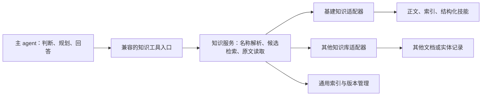

# 知识库检索增强调研与离线实验

日期：2026-10-13。性质：工程研究与实验记录，不入玩家知识语料。没有修改主 agent、网站、RIIC-KnowledgeAgent、知识正文或现有派生索引。

结论：值得在现有知识工具内部增加正文检索，先以 BM25 建立对照，再评估向量召回和重排。主 agent 继续判断问题、调用知识工具、读证据与决定答案。当前实测支持“正文召回能改善候选文档覆盖”，尚不能证明最终回答准确率或整段对话速度提高。简单把标题路由与正文检索等权融合，在本次题集上弱于单独 BM25，因此不能把“混合”直接当作更好。

## 1. 调研范围与原有行为

检查了三个来源：

- 本知识库：AGENTS.md、共享知识规则、skill-1、启用清单、导诊表、标题索引、消歧字典、生成脚本、12 道问答样例和 82 道评论题。
- 网站现有实现：`E:/arkriicinfra/riicweb/src/server/agent/knowledge.ts`；另对照 `riicweb-develop-facilities` 同名文件及 `resource-policy.ts`。两份 knowledge.ts 的核心检索相同，后者增加资源快照输入。
- 参考项目：`E:/佩奇knowledgeagent/RIIC-KnowledgeAgent` 的 retriever、corpus、facts store、tool executor、hitrate，以及检索送达 ADR 与三轮真实回答核查记录。该本地目录没有 Git 元数据，本文不能给出其精确 commit，也没有将远程 HEAD 当成本地版本。

现有主流程的价值在于：消歧、领域路由、按事实分工取证、计算边界、友好引用。它已经属于检索增强的做法；RAG 不要求必须使用向量数据库。需要增强的是检索实现和证据送达。

网站 `kb_route` 目前：

1. 读取标题清单，提取文件路径与标题、小节说明。
2. 读取消歧字典，扩展部分组合、干员和同效技能名称。
3. 用查询字符串、词段和中文双字片段匹配路径与标题，取最多 8 份文件。
4. 主 agent 用 `kb_read` 读正文，每页最多 16,000 个 UTF-16 字符。

重要区别：本库指引描述的“消歧→模块路由→小节索引→正文”是 agent 的完整取证流程；网站这个函数只做候选排序，没有在函数内执行完整导诊表，也没有搜索正文。本实验的“现有路由”基线指该实际函数，不代表主 agent 的完整能力。

## 2. 当前语料与准确性风险

本次工作区实测 112 份 docs Markdown，约 1 MB；8 份 `type: index` 导航，104 份正文候选。不是根 AGENTS.md 仍记录的 111 份。正文里有 5 份 draft；15 份生成快照或速查页没有 front matter。全库约 47 万 UTF-16 字符，未测模型 token 数。

| 观察 | 对调用的影响 | 建议 |
|---|---|---|
| 标题索引含 type/updated，没有 status；网站候选也没有 status | draft 容易与已审定内容混用 | 从正文派生机器元数据，候选明确区分可信正文、草稿和导航 |
| 技能快照没有 front matter | 机械筛选 `status=canonical` 会误删技能真源 | 适配器识别受管生成产物并登记来源/版本，不能把所有无状态文档自动判为可信 |
| 导诊表仍挂载 skill-2/5/8 | 与启用清单、共享规则冲突 | 实际加载以 manifest 为准，治理层另行清理漂移 |
| 导诊表仍写注册表>总览>深稿的全局顺序 | 与当前“按命名、条件、分支、机制分工核对”不一致 | 不能把文件总等级硬编码成检索权威分数 |
| 12 题中只有 5 题已校准，7 题待校准 | 样例答案不能直接当作最终正确性裁判 | 建立可追溯的必答点与当前可信正文依据 |
| 样例 8 引 buff 叠加模型，10/11 引定时换班，当前均为 draft | 信任过滤与原始 gold 有冲突 | 保留“原始参考命中”指标，另建“当前可信证据覆盖”；不为成绩将草稿升为 canonical |
| canonical 页面也有指向 draft 的链接 | 引用关系不保证目标已审定 | 扩展引用时重新检查目标状态，不沿链接继承权威 |
| 快照、速查大表与机制散文混在同一个排序空间 | 同效技能/泛化词可能占满候选 | 精确事实查询与散文检索保持分工，在适配层配置分区与去重 |

上述问题不会由 embedding 自动解决。语义相关、版本适用、证据可信和问题覆盖是四个不同的判断。

## 3. 本次实际测试

脚本 `benchmark.mjs` 直接加载网站和参考项目 TypeScript 源码，使用 Node 的类型剥离后在内存中导入；未复制修改生产源码。网站只替换 `server-only` 导入与知识库目录函数；参考 BM25 固定为现有 bigram、entityBoost=0，移除未使用的 jieba 依赖。参考语料解析器直接使用其 `splitChunks`。

测试集在跑测前登记：12 道原题、对应 12 道自然语言改写、12 道额外问题，共 36 道。参数未按成绩调优。全部 82 道已有评论题也执行了检索并保存候选，但没有人工 gold，不计算准确率。运行时输入只有问题与知识索引，评测答案和 gold 不进入检索。

对每题最多返回 8 份去重文档，对比五组：

| 标识 | 实现 |
|---|---|
| route | 网站现有标题路由 |
| reference_bm25 | 参考项目标题分块 + 原始 BM25，按首个块命中聚合为文件 |
| contextual_bm25 | 去掉 front matter、保留标题祖先链、索引别名扩展 + 同一个 BM25 |
| route_raw_bm25 | 现有路由 + 原始 BM25，用 RRF 等权融合 |
| route_bm25 | 现有路由 + 上下文 BM25，用 RRF 等权融合 |

后两组 RRF 的 k=60，各路最多 30 份候选；标题路由本身最多 8 份。这里的“上下文”是直接派生的标题与别名，不是模型生成的摘要。前三组及融合组都不是向量检索。原始参考解析得到 1,477 块，补充上下文的解析得到 1,436 块。

每组重复 3 次，轮换执行顺序，共 540 条带标签记录；另有 410 条未标注评论题记录。三次排名完全一致，重复只检验确定性与本地计时，不是主 agent 的三轮作答。新增两组消融只是分析融合与分块的影响，没有为特定题目增加运行时规则。

“参考覆盖率”定义：对每题参考文档组计算 Recall@8，再对题目取平均。有多条等效参考文档时命中任意一条即可。它不是 precision、不是小节证据覆盖率、不是最终回答正确率。参考文档集不是所有可支持答案材料的穷举。

| 方法 | 12 原题参考覆盖 | 12 改写题参考覆盖 | 12 额外题参考覆盖 | 36 题参考全部命中 | 36 题平均参考覆盖 |
|---|---:|---:|---:|---:|---:|
| 标题路由 | 59.7% | 39.6% | 100% | 20/36 | 66.4% |
| 原始 BM25 | 93.1% | 79.9% | 100% | 29/36 | 91.0% |
| 上下文 BM25 | 88.9% | 79.9% | 100% | 28/36 | 89.6% |
| 路由 + 原始 BM25 | 84.7% | 52.1% | 100% | 24/36 | 78.9% |
| 路由 + 上下文 BM25 | 84.7% | 56.3% | 100% | 24/36 | 80.3% |

额外题多为对象明确的单点题，而且只要求一组参考，三种主要方法均 100%，没有区分力；不能据它得出泛化已经验证。需要从剩余评论题补充经审定的长尾、多事项和缺失证据题。

排序还影响阅读成本：

| 方法 | 原题前 1 份参考覆盖 | 原题前 3 份参考覆盖 | 原题前 8 份参考覆盖 |
|---|---:|---:|---:|
| 标题路由 | 20.8% | 29.9% | 59.7% |
| 原始 BM25 | 17.4% | 56.9% | 93.1% |
| 上下文 BM25 | 28.5% | 61.8% | 88.9% |

上下文 BM25 的整体 MRR 为 0.660，原始 BM25 为 0.604，路由为 0.532。上下文能把部分相关材料提前，但本次同时改了分块与扩词，不能把变化单独归因于某一因素。原始 BM25 的前一份覆盖甚至比标题路由低；高 Recall@8 并不保证少读一份就能作答。

具体失败分析：

- 原题 5（月产折抽），标题路由只命中 3 组参考中的 1 组，原始 BM25 命中全部；原题 6（订单组合比较）、9（优先培养）也有明显的正文召回收益。
- 原题 7（多体系缺员）、8（中枢与宿舍）在 BM25 下仍不完整；需要独立事项分别取证和主 agent 继续检索，不能把单次 topK 当证据闭包。
- 改写题 6“金条不足、选但书/巫恋组/可露希尔”，原始 BM25 漏掉指定的锚点/取舍参考；别名与词法相关性都无法保证取得问题要求的比较口径。
- 简单等权 RRF 会把实体关联的组合、快照文件推上去，挤出锚点或专家取舍页。两组融合均弱于正文 BM25，不能直接采用。未来可以评估按意图分区、有限额路由加分、保留每个子问题的候选，而不是继续按这 12 题改权重。

本实验直接把完整题干传给工具。生产主 agent 常先提炼关键词，可能分批检索、查技能和沿链接读正文；本实验既没有测它的查询改写，也没有测它的回答。结果说明函数在固定输入上的表现，不能换算成线上 agent 从 60% 提升到 93%。

## 4. 延迟与资料时效

本机三次重复的全部 36 题查询耗时如下，包含检索实现本身，不含模型、网络、工具调用编排和正文阅读：

| 方法 | p50 范围 | p95 范围 |
|---|---:|---:|
| 标题路由 | 1.9–2.3 ms | 2.7–5.1 ms |
| 原始 BM25 | 6.7–7.9 ms | 12.4–15.7 ms |
| 上下文 BM25 | 7.2–9.5 ms | 12.8–17.3 ms |
| 路由 + 原始 BM25 | 9.3–12.0 ms | 16.4–19.7 ms |
| 路由 + 上下文 BM25 | 9.5–10.4 ms | 15.2–15.4 ms |

这是单进程、预构建索引后的查询，两个 BM25 索引合计构建约 0.2 秒；程序导入和语料读取不在该构建数内。机器负载、缓存与 JIT 会使毫秒数字波动，它们不是部署 SLA。现有路由每次重新读/解析约 238 KB 的消歧 JSON，也是可缓存的工作。BM25 使用逐文档词频扫描，扩大语料后应改倒排表，不必复用其扫描实现。

正文召回多花几毫秒，可能减少后续查询和模型轮数；重排或远程 embedding 也可能增加网络耗时。究竟更快，必须测“发问→首次证据→最终回答”的端到端 p50/p95、读文档次数和累计输入 tokens，不能从查询毫秒数推出。

`contract-probes.mjs` 用隔离夹具复现了更新行为：

1. 旧标题索引载入缓存后，修改索引与正文。
2. 60 秒 TTL 内仍返回旧标题说明，但 `kb_read` 读到新正文。
3. 模拟时间推进到 60,001 ms，下一次路由取得新索引。

没有修改真实资料，也没有实际等待一分钟。它证实本地文件入口能在同次会话混用不同更新状态；不代表正文一定错误。网站的 resource-policy 分支已有可注入的知识文件版本，是更适合继承的基础。

建议更新链：可信正文/受管快照更新 → 生成元数据、消歧与索引 → 构建词法/向量产物 → 校验 → 一次发布新知识版本。每次回答内的搜索、读取、精确事实查询使用同一个版本；已有会话是否切版本由宿主统一决定。删除、改名也要同步移除旧块。

`updated` 是内容维护日期，不证明某服务器/游戏版本适用，也不证明上游刚检查过。库没有明确游戏适用版本的地方，不得根据更新时间补造它。游戏适用范围、上游抓取点和构建版本应按知识源实际提供的信息登记，未知就保持未知。无需为此给所有正文增加复杂字段，可用生成的 sidecar 元数据；内容真源仍为正文。

缓存按知识版本划分；答案缓存还必须包含问题、用户状态与计算输入，不能跨不同 box 复用。向量不能只增不删。向量索引落后时可使用同版本的词法/正文能力；不能拿当前正文配旧向量结果而不校验来源版本。时效指标应分别记“资料落地→可检索”和“资料更新→回答改用新规则”。

## 5. RIIC-KnowledgeAgent 的可借鉴部分

它的 `hybrid` 是“BM25 散文检索 + facts 查询”，不是通常所说的“BM25 + dense vector”。当前 retriever 没有 embedding 或向量数据库。借鉴它的工程结构比照搬整个 agent 更有价值。

| 组件/设计 | 可借鉴点 | 抽象边界与本库适配 |
|---|---|---|
| retriever.ts | 中文 bigram、索引与查询使用同一分词器、BM25 基线 | 去掉全局 EXPERIMENT 与手工 ENTITY_WORDS 依赖，配置和词典由适配器注入；大库用倒排表 |
| corpus.ts | 显式语料准入、路径与物理根校验、标题分块、来源行号 | 不固定 base/guides/facts 前缀；完整剥离 front matter、用 Markdown 结构处理代码块、表格和列表 |
| facts store | 规范词条、别名、多候选、解锁/替换关系、精确查询 | 作为可选实体记录适配器；operator/room/faction/class 等是基建插件，不属于通用检索内核 |
| 原文目录与 read | 文档/小节入口、短预览、分页与 complete/nextOffset | 使用命名空间 ID，不能用跨库可能同名的 `doc:<文件名>`；“读完范围”不等于“问题已解决” |
| 关联事实与证据台账 | 区分命中、实际返回、被模型读取、答案覆盖 | 通用服务记录来源范围、版本、截断与错误；可选关联由适配器显式登记 |
| benchmark/hitrate | 运行输入、候选、送达、成本、失败分层 | 抽出与 provider、基建题号、答案 spec 无关的评测接口；业务裁判留题集侧 |

不宜直接沿用：领域词表常驻、固定目录结构、六类 facts 分类、具体基建事实卡 schema、特定模型的预算与行为回馈、100 字预览/4,000 字事实区等固定额度、独立查询 agent 的 system prompt 和 agent loop。这些都应变成配置或领域插件，预算保留宿主控制。

参考项目的 `splitChunks` 目前只跳过 `---` 行而非整个 front matter；本库大量使用 YAML，直接搬会让元数据混入检索正文。其锚点还解析旧 `operators` 字段，而本库组合 schema 已用 `members`。本次保留原始实现作为对照，不把它当成可直接上线的通用 parser。

参考项目已有 20 题、GLM low、同配置三轮记录：必答点满足数 63/72、66/72、63/72，“完整且有据”10/20、13/20、11/20。三轮 24 个遗漏中，18 个被记录为证据已送达但未覆盖，4 个未送达，2 个部分送达。这是其历史记录，题集、语料、主 agent、模型和判定条件都与本库不同，且其报告注明判定宽严与采样混淆。只能用来说明“更会找资料不保证一定更会答”，不能用于预测我们的准确率。

## 6. 外部参考及其适用范围

- Microsoft 的 [Hybrid search overview](https://learn.microsoft.com/en-us/azure/search/hybrid-search-overview) 说明词法与向量召回并行、RRF 合并，分别处理精确词与语义相近问法。可借鉴方法，不需要因此选用 Azure。
- Anthropic 的 [Contextual Retrieval](https://www.anthropic.com/news/contextual-retrieval) 讨论分块失去上下文、BM25 对精确标识的作用、embedding+BM25+rerank。其报告 top-20 检索失败率相对下降 49%、加重排后 67%；这是其数据集上的失败率相对下降，不是准确率增加 49/67 个百分点，更不是本库预期。我们优先从确定性的文档标题、父标题、别名和条件保留开始，不需要先用模型给全部块编总结。
- [Lost in the Middle](https://aclanthology.org/2024.tacl-1.9/) 说明被研究模型对长上下文中的证据位置敏感。支持测实际送达与阅读，不证明当前主模型一定有同等程度的问题。

优先级判断：BM25 已有本库实测收益；向量召回适合语义改写、没有共享关键词的问法，但本次未实测；rerank 适合压缩候选和提高前几条排序，但会增加运行成本；GraphRAG 更适合大量关系、多跳及全局概括，目前先利用现有引用与组合结构，无需引入图数据库。生成式 query rewrite/检索子 agent 会增加模型轮次，并改变问题解释路径，不作为“主逻辑不变”的第一步。

## 7. 保持主 agent 不变的接入方式

第一阶段只替换 `kb_route` 后端：输入仍是 question，输出仍是原有 matched.path/label/disambiguation/hint；`kb_read(path, offset)` 和 `query_skills` 不变。正文 BM25 在工具内部负责候选排序，agent 仍决定读哪篇、追问什么、是否调用计算工具。结构化技能服务继续负责原文与解锁，不由语义检索替代。

目前证据更支持“正文检索作为主召回，路由用于导航和受控补充”而非直接采用等权 RRF。是否保留已有某些精确路由优势，应通过独立题集验证。在可观察的 backend 选择中保留旧实现，按会话固定实验分组，方便回滚。

第二阶段如需小节阅读，可给 matched 增加可选 section_id 和原文预览，给 kb_read 增加可选 section_id，保留原来的全文分页语义。这是工具能力的向后兼容扩展，需要独立验证 agent 是否实际使用；不能暗中把 kb_read(path) 改成乱序摘录，也不能把查完某页当成证据齐全。

通用检索服务不直接生成面向玩家的最终答案，避免加入第二套人格、判断与计算逻辑：



## 8. 面向更多知识库的最小抽象

建议抽象“知识来源 + 检索能力”，不把 RIIC-KnowledgeAgent 改成第二个通用主 agent。内核只负责扫描准入、解析分块、索引、排名、去重、版本、原文读取及观测；领域适配器提供语料边界、元数据解析、消歧、精确记录与引用关系。

| 接口 | 通用职责 | 基建实现 | 其他知识库 |
|---|---|---|---|
| resolve | 返回规范对象、候选及歧义 | 消歧字典、同效技能、子串规则 | 术语/产品/人物别名，可缺省 |
| search | 按问题与显式过滤召回文档/小节 | 正文 BM25，可选向量与路由信号 | 任意正文索引 |
| read | 按已返回 ID、版本、范围读原文 | Markdown 小节或全文分页 | PDF 页面、文档段落等 |
| records（可选） | 精确字段查询及来源 | 现有技能与解锁记录 | API/产品参数/条款记录，或不支持 |

服务请求显式绑定知识源集合与版本；第一阶段只有基建，宿主在内部绑定默认知识源，不向主 agent 增加选库步骤。未来多库路由先返回来源能力摘要，避免把所有标题目录塞入系统提示词。库级筛选可由宿主会话配置完成；泛化问题必要时跨库检索，不因模块路由丢掉其他库的证据。

最小结果需要：`kb_id`、`knowledge_version`、`doc_id`、可选 `section_id`、友好标题与标题链、原文范围、内容状态、匹配路径、原文/预览、分页状态。评分只表示相关性，不表示答案可信概率。实体 kind 由插件定义，核心不得枚举 operator/room/faction；没有 facts 能力的库仍可 search/read，不为接入强制转换成干员式卡片。

ID 至少在知识源内唯一；跨库使用 `kb_id + doc_id + section_id`，不能仅用文件名。显示友好标题，工程记录保留精确来源。主仓库与公开派生库可以注册为同一逻辑来源的不同发布位置，避免将相同事实算作两个独立证据。冲突按主 agent 现有规则及来源声明处理，不能根据 BM25/向量高分自动裁决。

建议产物全部可再生成：生成的 corpus manifest、metadata、chunk store、词法索引、可选向量索引。同一事实只有 docs 维护位置，检索派生物不成为第二事实真源。配置源文件可以手工维护，事实元数据与关系从正文派生。知识版本优先使用明确的发布/构建版本与来源 Git 信息，本研究不要求额外增加哈希字段。

隔离状态与配置：每个知识来源实例拥有自己的词典、tokenizer 配置、索引、语料快照与缓存，禁止用进程级 EXPERIMENT/环境变量在并发请求间切换知识库。第三方库的自然语言规则不能自动覆盖宿主主 agent 的行为规范；能力摘要、事实证据与业务流程规则分开装配。

## 9. 下一阶段的受控多轮测试

要回答“最终效果如何”，应在既有主 agent 上只替换知识 backend，固定人格与知识规则、主模型和思考档、工具定义、计算工具、上下文策略、工具预算、用户干员池和知识版本。测试会话每题独立，候选检索相同证据预算；实验配置和错误均留档。

建议先用三组、每组 3 轮的 12 原题（共 108 次主 agent 会话）：

1. A：现有路由。
2. B：正文 BM25，保持现有工具返回与阅读形式。
3. C：BM25 + 真正的向量召回，保持同样形式；若尚未接好 embedding，可先完成 A/B，再补 C。

再将“是否重排”“是否小节送达”“是否结构化记录附带”逐项加入，避免一次同时换模型、系统提示、预算和检索。temperature 固定不保证完全确定性；保留全部重复，不挑最好的一轮。12 题用作开发集，原样保存；从剩余 70 道评论题抽取未参与调优且已有可信正文支撑的题作为留出集，另设确实缺证据和词条歧义题。不能用本研究已查看过的 12 道自造额外题冒充最终未见测试集。

原题 8/10/11 在可信证据口径未处理前分别报告，不把草稿答案当硬性金标准。需要计算的题测“是否正确使用宿主实际计算或说明具体条件”，不能要求检索框架执行 skill-2/5/8。保留题目中错误前提的纠偏能力。

| 层次 | 指标 | 需要记录的证据 |
|---|---|---|
| 名称与范围 | 歧义正确处理、实体遗漏、错误设施/版本 | 解析候选、采用条件、知识版本 |
| 召回 | 文档/小节 Recall@k、MRR、无结果与工具错误 | 原始查询、扩展查询、排名、来源范围 |
| 送达 | 必答证据实际送达比例、截断、阅读与重读次数 | 实際原文切片、complete/nextOffset、每次输入量 |
| 回答 | 必答点满足/遗漏/冲突、额外错误断言、引用支撑 | 每个断言对应正文，而非模型印象打总分 |
| 时延成本 | 首次证据与最终回答 p50/p95、模型轮数、tokens、费用 | 请求时间线与真实 provider usage |
| 更新 | 修改/新增/删除/改名生效延迟、旧内容残留 | 隔离更新夹具与版本切换记录 |
| 扩展 | 两库同名对象、同名文件、无 facts 库、并发隔离 | 额外的非基建夹具，不复用基建专名规则 |

检索评价用来源标签，回答评价用必答点与额外断言；人工复核重要冲突。外部模型可以辅助评分，不能把评测答案或检索 gold 注入待测 agent，也不能按题号给 backend 特判。多轮结果按题配对报告与失败分类；小题集只给观察，不宣传稳定提升比例。

本次没有调用付费模型，没有取得 embedding/重排向量测试结果，也没有运行主 agent 的端到端 A/B。参考目录没有现成依赖、编译产物或 secret.yaml，不能直接执行它的真实 bench；更重要的是，直接运行其独立 agent 不满足“我们的主 agent 逻辑不变”的条件。本研究已经完成可零费用复现的检索对照、资料更新探针和后续协议设计。

## 10. 推荐实施顺序与可复现材料

推荐顺序：先统一资料状态/启用清单与评测口径，再把 BM25 接到现有工具内部并跑固定主 agent A/B，然后根据留出题是否仍有语义漏检，决定加入向量；若首几条排序/阅读成本仍差，再评估 rerank 和小节读取。多知识库接口在 backend 边界设计，领域精确记录保持插件化。当前证据不支持直接搬整个参考 agent 或立即采购重型向量/图谱平台。

实验目录中的文件：

- `cases.json`：原题标签、改写与额外问题；评测参考不入语料。
- `benchmark.mjs`：加载实际网站路由、参考 BM25 并跑五组检索。
- `results.json`：540 条带标签、410 条未标注结果与元数据。
- `run-summary.json`：首轮汇总与语料统计。
- `contract-probes.mjs` / `probes.json`：隔离更新探针与计量检查。

在主仓库根执行：

```powershell
node meta/research/2026-10-13-rag-evaluation/benchmark.mjs
node meta/research/2026-10-13-rag-evaluation/contract-probes.mjs
```

Node 需支持 `stripTypeScriptTypes`（本次 v22.21.1）。外部源码路径可用 `RESEARCH_WEB_ROOT` 与 `RESEARCH_REFERENCE_ROOT` 覆盖。重新运行会更新实验 JSON，不修改正文或其他项目；如外部源码或知识正文变化，结果不再是同一次快照，应按新实验解读。
